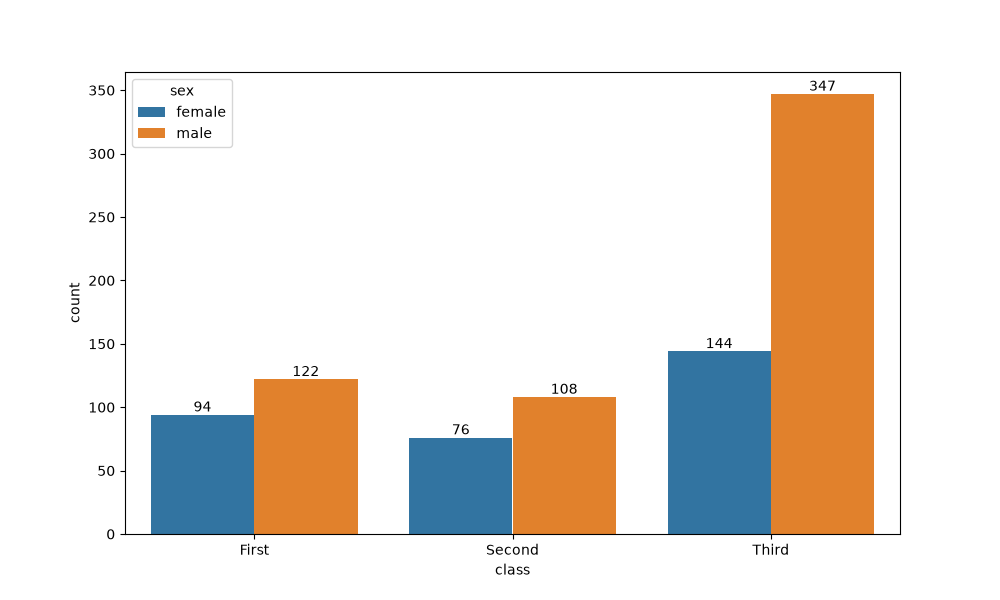
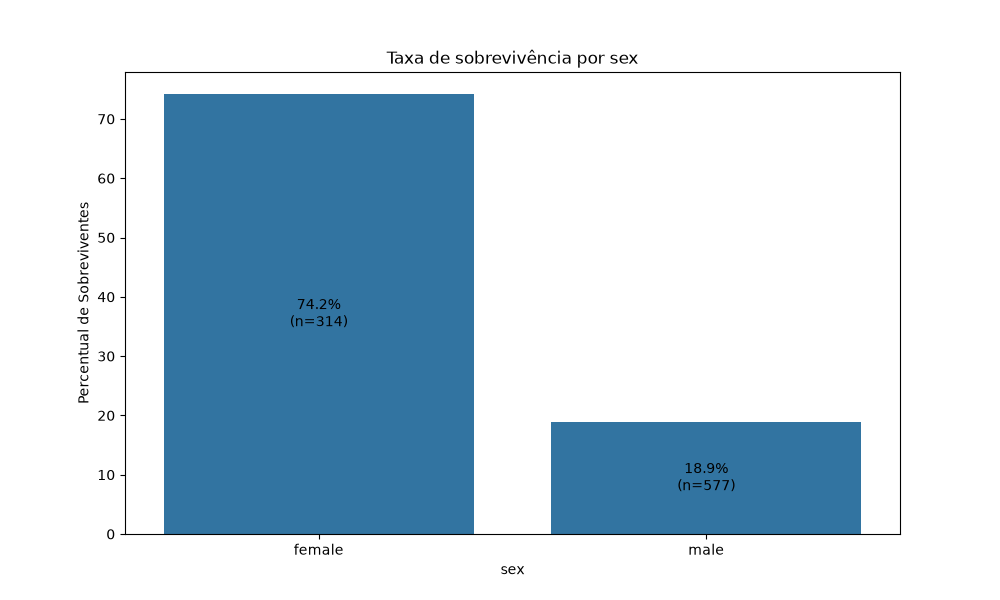
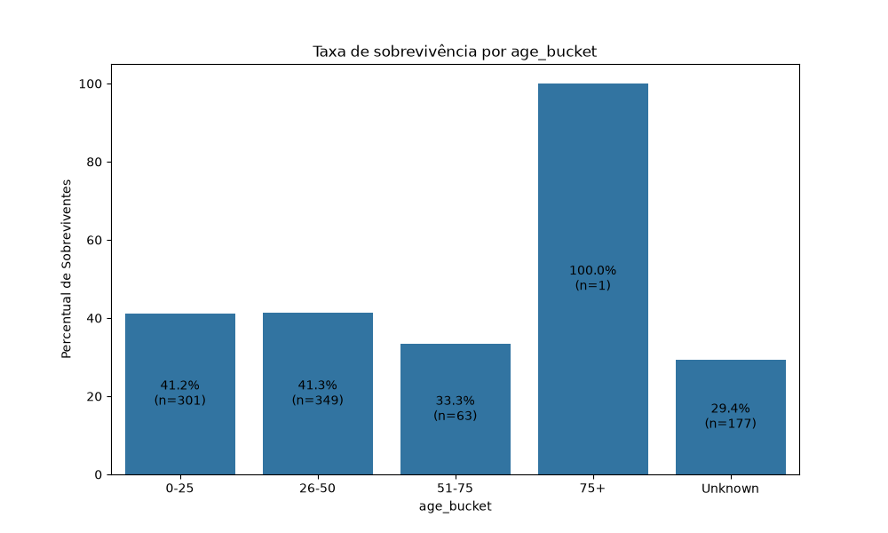

# Portfólio de Data Science

Registro da minha jornada aprendendo Python, boas práticas de código e ciência de dados, do básico até projetos aplicados.

## Objetivo
Construir fluência em Python escrevendo o código eu mesmo e aplicar conceitos de ciência de dados em problemas reais.

## Estrutura
- `src/`: funções reutilizáveis
- `tests/`: testes automatizados com pytest
- `notebooks/`: análises e experimentos
- `data/`: dados (os brutos não vão para o Git)

## Progresso
| Aula | Tema | Status |
|------|------|--------|
| 00 | Ambiente, funções de média e mediana, testes | ✅ |
| 01 | Listas, dicionários e comprehensions | ✅ |
| 02 | Funções, validação de tipos e testes parametrizados | ✅ |
| 03 | Pandas, nulos, taxas e séries | ✅ |
| 04 | Seaborn, Matplotlib e visualizações de dados | ✅ |
| 05 | Statsmodels, regressão linear e estatística | ✅ |

## Como rodar
```
python -m venv .venv
.venv\Scripts\activate
pip install -r requirements.txt
python -m pytest
```

## Aprendizados
- Aula 0
    - Erros devem lançar exceções, não retornar texto.
    - `/` sempre devolve float; para índices, use `//`.
- Aula 1
    - O nome de um teste deve dizer o que ele testa.
    - Para somar por categoria, acumule num dicionário com dict.get(chave, 0).
    - if __name__ == "__main__" evita que o código rode quando o arquivo é só importado.
- Aula 2
    - Type hint ajuda o usuário a passar a estrutura correta na função, mas para garantir que foi passado corretamente usamos `isinstance` para verificar
    - `TypeError` é lançado quando a função espera a estrutura A e recebe B, `ValueError` é lançado quando o valor passado não respeita o funcionamento da função, `KeyError`é passado quando um dicionário não apresenta determinada chave.
    - Podemos usar `parametrize` da biblioteca `pytest` para lança uma coletânea de testes em uma função
    - Dentro do `parametrize` é passado uma lista de tuplas, deixar tuplas soltas, faz com que a função considere cada valor da tupla uma entrada.
    - Antes de usar um dado, eu preciso verificar sua classe pois isso influencia o comportamento de funções ao longo do código.
    - Sempre pensar em 'falhar rápido' na função, isso economiza tempo e processamento, logo devemos deixar no inicio das funções as verificações e erros.
    - Usar a `docstring` como um contrato da função, deixando claro sua responsabilidade e entrega.
    - Se a função fizer A **E** B, é um indício de que devemos ter duas funções, uma para A e outra para B.
- Aula 3
    - Coluna `deck` apresenta mais de 70% de valores nulos
    - Crianças e mulheres sobreviveram do que homens, o que pode ser explicado pelo operacional de emergência que prioriza crianças e mulheres para entrar nos botes.
    - Atributos, funções e manipulação de Pandas DataFrames.
    - Limpeza de dados faltantes, função simples de taxa.
    - Testes para casos de borda.
    - Usar dropna() ao invés de fillna() depende do problema e nesse caso não faz sentido assumir valores para o cálculo de taxa.
    - A parte exploratória é fundamental para entender os dados antes de sair calculando métricas, entender que uma coluna tem mais de 50% de valores faltantes é fundamental.
    - Utilizar `pip freeze > arquivo.txt` para gerar a lista de bibliotecas exigidas.
- Aula 4
    - Utilizamos algumas visualizações para mostrar resultados de nossas funções.
    - Vemos na terceira classe os homens eram mais que o dobro das mulheres. 
    - Entre primeira e segunda classe a relação homem:mulher é de 1,3 e 1,4 respectivamente.
    - A sobrevivência entre mulheres é de ~74% enquanto entre os homens é de ~18% 
    - Vemos que, apesar dos idosos de 75 ou mais anos de idade sobreviveram enquanto o grupo entre 51 e 75 anos apresentaram uma taxa de sobrevivência de ~33%.    
    - Os testes em funções que geram imagens focam em ver se o caminho da imagem existe após ser chamada.
    - Para funções de imagens, é melhor separar em uma função que prepara os dados e outra que gera a imagem.
    - Vemos pelos dados que o protocolo de emergência parece ter funcionado, vemos as maiores taxas de sobrevivência entre os mais novos e de sexo feminino.
- Regressão Simples e Statsmodels
    - Utilizamos o notebook  para uma análise do banco de dados "mpg" de carros e o objetivo era estudar regressão linear utilizando a biblioteca "statsmodels".
    - Para a tarefa, tentamos predizer a variável "mpg" utilizando "horsepower" e "weight".
    - A dispersão das variáveis de interesse:   e 
    - Podemos avaliar que o modelo mais simples "mpg ~ horsepower + weight" não era o ideal devido aos resíduos . Eles apresentam heterocedasticidade (No gráfico de resíduos vs. previstos a nuvem de pontos tem formato de U e aumento da variação em forma de funil) além de apresentar assimetria à direita (Q-Q Plot com pontos acima da reta de 45°).
    - Já para o modelo "log(mpg) ~ horsepower + weight" tivemos o melhor modelo entre os testados, com resíduos sem heterocedasticidade aparente e assimetria menor à direita. .
    - Por último, testamos um modelo com a variável "weight" ao quadrado "mpg ~ horsepower + weight" mas essa transformação não foi capaz de capturar o comportamento não linear entre as variáveis, mantendo os mesmos problemas do modelo 1 .
